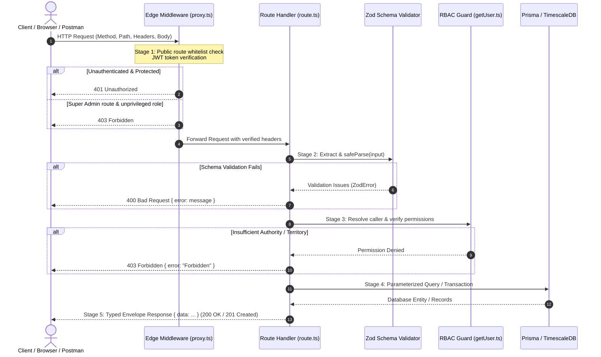

# Day 4 · Task 4: Server-Side Validation Architecture & End-to-End Trace

**Platform:** GRID-INDIA IITB (GI-IITB) Renewable Energy Forecasting Platform  
**Report Date:** 2026-10-19  
**Source Code References:** `src/app/api/series/route.ts`, `src/app/api/admin/users/route.ts`, `src/proxy.ts`, `src/lib/getUser.ts`, `src/lib/errors.ts`  
**Deliverable Target:** `reports/week-1/day-04/task-04-validation-trace.md`

---

## 1. Architectural Request Pipeline

In the GRID-IITB platform, every HTTP transaction passes through a rigorous five-stage pipeline before touching persistent state:



---

## 2. End-to-End Route Trace: `GET /api/series`

The time-series forecasting endpoint demonstrates input validation, composite parameter resolution, and temporal time-zone conversion.

### A. Stage 1: Input Parsing
Parameters arrive as URL query search params:
```typescript
const params = Object.fromEntries(req.nextUrl.searchParams)
```

### B. Stage 2: Zod Schema Validation & Coercion
The route defines a polymorphic schema accepting either a direct `run_id` (UUID) or a composite lookup of four fields (`region_id` + `date` + `revision` + `model_name`):

```typescript
const schema = z.object({
  plant_id:   z.string().uuid(),
  run_id:     z.string().uuid().optional(),
  region_id:  z.string().uuid().optional(),
  date:       z.string().regex(/^\d{4}-\d{2}-\d{2}$/).optional(),
  revision:   z.string().optional(),
  model_name: z.string().optional(),
}).refine(
  (d) => d.run_id || (d.region_id && d.date && d.revision && d.model_name),
  { message: "Provide either run_id OR (region_id + date + revision + model_name)" }
)

const parsed = schema.safeParse(params)
if (!parsed.success) return badRequest(parsed.error.issues[0].message)
```

* **Security Impact:**
  - `plant_id: z.string().uuid()` rejects SQL injection vectors and arbitrary strings immediately.
  - `date: z.string().regex(/^\d{4}-\d{2}-\d{2}$/)` guarantees strict `YYYY-MM-DD` ISO date formatting, preventing database date parsing errors.
  - `.refine(...)` prevents incomplete combinatorial state that would otherwise cause null-pointer dereferences in backend data queries.

### C. Stage 3: Authorization & Territory Isolation
```typescript
const user = getAuthUser(req)
```
The server checks `user.allowedRegionIds`. If the caller is a regional dispatcher restricted to Gujarat (`GJ`), attempting to pass a Rajasthan (`RJ`) region ID will fail regional security boundaries.

### D. Stage 4: Server Helpers & Data Mapping
The route uses helper `istDateToUtcRange(date)` from `src/lib/time.ts` to compute exact UTC microsecond boundaries for Indian Standard Time (IST):
```typescript
const { gte, lt } = istDateToUtcRange(date!)
const run = await prisma.forecastRun.findFirst({
  where: { regionId, modelName, revision, runT0Utc: { gte, lt } }
})
```
It then reads `prisma.miPrediction.findMany()` with ordered timestamps (`orderBy: { validTimeUtc: "asc" }`).

### E. Stage 5: Response Shaping & Type Envelope
```typescript
return ok({
  runId: resolvedRunId,
  items: rows.map((r) => ({
    validTimeUtc:       r.validTimeUtc,
    validTimeIstLocal:  toIST(r.validTimeUtc),
    ghiPredWm2:         r.ghiPredWm2,
    powerPredMw:        r.powerPredMw,
    solarPowerPredMw:   r.solarPowerPredMw,
    windPowerPredMw:    r.windPowerPredMw,
  })),
})
```
The caller receives guaranteed types: ISO strings for UTC, formatted strings for local IST, and floating-point numbers for power generation.

---

## 3. Comparison: Frontend Caller Types vs Route Backend Types

| Domain Model | Client-Side Caller Type (`Frontend`) | API Route Validation Schema (`Backend`) | Database Entity Type (`Prisma Model`) |
| :--- | :--- | :--- | :--- |
| **User Role** | `'super_admin' \| 'admin' \| 'user'` | `z.enum(["admin", "region_admin", "state_admin", "ists_admin"])` | `enum UserRole` in PostgreSQL |
| **Plant Capacity** | `number` (or string from `<input>`) | `z.number().positive().max(10000)` | `Float` in Prisma Schema |
| **Forecast Date** | `string` (`"19-10-2026"` in UI) | `z.string().regex(/^\d{4}-\d{2}-\d{2}$/)` | `DateTime` (Stored as UTC in database) |
| **Status Envelope** | `{ success: boolean; data?: T }` | `{ data: T } \| { error: string }` | Raw table record row |

### Why Types Must Be Re-Checked at the Route
In TypeScript, compile-time types exist **only during development and compilation**. Once the code is compiled to JavaScript and running in production:
- Client-side TypeScript types **vanish entirely** (type erasure).
- The network boundary receives raw HTTP text strings.
- **Zod schemas provide runtime type enforcement**, validating that incoming strings actually conform to the expected shapes before the code assumes they are safe.

---

## 4. Deep-Dive: Why Validating Only in the Browser is Insufficient

A common misconception among beginner developers is: *"If my React form prevents submitting when the date is empty or invalid, the system is secure."*

**Validating only in the browser is fundamentally insufficient for the following critical reasons:**

### 1. The Browser is an Untrusted, Attacker-Controlled Client
Anyone with basic developer skills can open their browser DevTools (F12) and:
- Remove HTML `required`, `pattern`, `min`, `max`, or `disabled` attributes in the DOM.
- Modify JavaScript variables in memory via breakpoints.
- Execute raw `fetch()` or `XMLHttpRequest` directly from the DevTools console with arbitrary payloads.

### 2. Direct HTTP Tools Bypass the Browser Entirely
Client-side validation runs inside the web browser. However, HTTP APIs can be invoked directly by:
- **Postman / Insomnia**
- **cURL commands** (`curl -X POST http://server/api/admin/users -d '{"role":"super_admin"}'`)
- **Automated scripts / Bots** (Python `requests`, Node.js `axios`, Go scripts)

These tools do not execute React validation hooks, DOM events, or frontend form checks. If the server does not validate the payload, the invalid or malicious data reaches the database directly.

### 3. Data Integrity & Grid Operational Catastrophe
In power grid management:
- If a client bypasses the UI and sends a negative value for power capacity (`capacityMw: -500`), and the server blindly saves it, automated merit-order dispatch algorithms will miscalculate national reserve margins.
- A single unvalidated null timestamp can break time-series sorting for all 96 dispatch blocks, leaving national grid despatchers blind during peak ramp hours.

### 4. Privilege Escalation & Security
Consider user creation:
- The UI might hide the `"super_admin"` role option for non-super-admins.
- If the server route handler does not verify caller clearance and validate the `role` field with `creatableRoles(caller.role)`, an attacker can send `"role": "super_admin"` in the JSON body and grant themselves full national grid control.

### Summary: The Principle of Defense in Depth

```
┌───────────────────────────────────────┐
│        Client Browser (UI)            │  Provides Instant User Feedback (UX)
│  (HTML5, React Hook Form, State Checks)│  [NOT A SECURITY BOUNDARY]
└──────────────────┬────────────────────┘
                   │ Network (Untrusted)
                   ▼
┌───────────────────────────────────────┐
│       Server Edge / Proxy Middleware  │  First Security Perimeter
│     (JWT Auth, Rate Limiting, CORS)   │  [REJECTS UNAUTHENTICATED REQUESTS]
└──────────────────┬────────────────────┘
                   │
                   ▼
┌───────────────────────────────────────┐
│     Server Route Handler (Zod Schema) │  Authoritative Validation Perimeter
│   (Type Coercion, Value Bounds, Regex)│  [REJECTS CORRUPTED / MALICIOUS DATA]
└──────────────────┬────────────────────┘
                   │
                   ▼
┌───────────────────────────────────────┐
│       Persistent Storage (Database)   │  Clean, Guaranteed Relational State
└───────────────────────────────────────┘
```

* **Client validation is for User Experience** (instant error highlighting, preventing unnecessary network calls).
* **Server validation is for Security, System Survival, and Data Integrity.**

