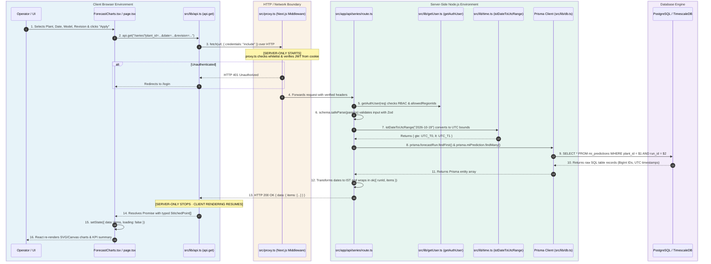

# Day 5 · Task 1: End-to-End Read Data Flow Architecture Trace

**Platform:** GRID-INDIA IITB (GI-IITB) Renewable Energy Forecasting Platform  
**Report Date:** 2026-10-19  
**Target Request Traced:** `GET /api/series` (Time-series forecast predictions and actuals)  
**Deliverable File:** `reports/week-1/day-05/task-01-data-flow.md`

---

## 1. Executive Summary

This trace maps the end-to-end lifecycle of a read-only telemetry dashboard query. It details the transition points across the client-server boundary, identifying the exact files, functions, data structures, and database queries involved, and clarifies where server-only code terminates and client-side reactive rendering begins.

---

## 2. Architectural Sequence Diagram



---

## 3. Granular Step-by-Step Code Trace

### Stage 1: Client Request Trigger (`D:\grid-iitb\src\app\page.tsx`)
1. **User Action:** The operator selects `Gujarat SLDC`, plant `ACL_PSS3_KPS1_S`, date `2026-10-19`, model `NOWCASTING`, and revision `Rev-Latest`.
2. **Component State:** In `src/app/page.tsx`, the `handleApplyFilters` callback constructs URL query parameters:
   ```typescript
   const params = new URLSearchParams({
     plant_id: selectedPlant,
     region_id: selectedRegion,
     date: selectedDateStr,
     revision: selectedRevision,
     model_name: selectedModel,
   }).toString()
   ```
3. **Client API Call:**
   ```typescript
   const data = await api.get<{ items: ForecastSeriesPoint[] }>(`/series?${params}`)
   ```

---

### Stage 2: Client Transport Helper (`D:\grid-iitb\src\lib\api.ts`)
The client uses a centralized fetch wrapper that manages CORS, credentials, and authentication failures:
```typescript
async function request<T = unknown>(endpoint: string, options: RequestInit = {}): Promise<T> {
  const url = `${config.apiBaseUrl}${endpoint}`

  const res = await fetch(url, {
    ...options,
    credentials: "include", // Automatically transports the HttpOnly "token" cookie
    headers: {
      "Content-Type": "application/json",
      ...options.headers,
    },
  })

  if (res.status === 401) {
    if (typeof window !== "undefined") {
      localStorage.removeItem("userInfo")
      window.location.href = "/login"
    }
    throw new Error("Unauthorized")
  }

  const json = await res.json()
  return (json.data ?? json) as T
}
```

---

### Stage 3: Edge Security Verification (`D:\grid-iitb\src\proxy.ts`)
Before any route handler code executes, Next.js Edge Middleware intercepts the request:
* **Function:** `proxy(req: NextRequest)` in `src/proxy.ts`.
* **Execution:**
  1. Checks if pathname starts with `/api/health` or other `PUBLIC_ROUTES`. Since `/api/series` is protected, execution proceeds to token extraction.
  2. Extracts token: `extractBearer(req.headers.get("authorization")) ?? req.cookies.get("token")?.value`.
  3. Verifies signature via `verifyToken(token)` using HMAC SHA-256 and `process.env.JWT_SECRET`.
  4. If invalid or missing, immediately halts request and returns `401 Unauthorized` without waking the application server or database.

---

### Stage 4: Server Route & Validation (`D:\grid-iitb\src\app\api\series\route.ts`)
Once forwarded through the proxy, the route handler executes:
1. **Identity & Territorial Check:**
   ```typescript
   const user = getAuthUser(req) // Throws if unauthenticated
   ```
2. **Query Parsing & Zod Runtime Schema Validation:**
   ```typescript
   const params = Object.fromEntries(req.nextUrl.searchParams)
   const parsed = schema.safeParse(params)
   if (!parsed.success) return badRequest(parsed.error.issues[0].message)
   ```
3. **Temporal Range Resolution:**
   Calls `istDateToUtcRange(date)` from `src/lib/time.ts` to convert the Indian Standard Time calendar day (`2026-10-19 00:00:00 IST` to `2026-10-19 23:59:59 IST`) into exact UTC boundaries (`2026-10-18 18:30:00 UTC` to `2026-10-19 18:30:00 UTC`).

---

### Stage 5: Database Query Execution (`src/lib/db.ts` / Prisma)
The route queries PostgreSQL/TimescaleDB via the Prisma ORM:
```typescript
const rows = await prisma.miPrediction.findMany({
  where: { plantId: plant_id, runId: resolvedRunId },
  orderBy: { validTimeUtc: "asc" },
})
```
* **SQL Query Executed:**
  ```sql
  SELECT id, run_id, plant_id, valid_time_utc, ghi_pred_wm2, power_pred_mw,
         power_actual_mw, solar_power_pred_mw, wind_power_pred_mw
  FROM mi_predictions
  WHERE plant_id = $1 AND run_id = $2
  ORDER BY valid_time_utc ASC;
  ```

---

### Stage 6: Response Shaping & Envelope Wrapping
The server shapes raw relational tuples into typed, frontend-ready JSON:
```typescript
return ok({
  runId: resolvedRunId,
  items: rows.map((r) => ({
    validTimeUtc:       r.validTimeUtc,
    validTimeIstLocal:  toIST(r.validTimeUtc), // Formats to "HH:mm" IST
    ghiPredWm2:         r.ghiPredWm2,
    powerPredMw:        r.powerPredMw,
    powerActualMw:      r.powerActualMw,
    solarPowerPredMw:   r.solarPowerPredMw,
    windPowerPredMw:    r.windPowerPredMw,
  })),
})
```

---

### Stage 7: Client Reactive Rendering (`ForecastCharts.tsx`)
1. The Promise resolves in `api.ts`, returning `data.items`.
2. React triggers state setter:
   ```typescript
   setForecastSeries(data.items)
   setIsLoading(false)
   ```
3. `ForecastCharts.tsx` consumes `forecastSeries` array:
   - Feeds `ghiPredWm2` into the upper Irradiance SVG chart line.
   - Feeds `powerPredMw` (green line) and `powerActualMw` (blue area) into the lower Generation chart.
   - Computes KPI delta cards (`Peak Generation: 284.2 MW`, `Ramp Variance: +1.4%`).
4. **No full page reload occurs.** The interactive map, header, and filter controls retain their exact state.

---

## 4. Field Comparison: Database Entity vs. Frontend Need

| Field Name | Raw DB Entity (`mi_predictions`) | Sent in API JSON (`items[]`) | Consumed by UI (`ForecastCharts.tsx`) | Reason for Inclusion / Exclusion |
| :--- | :---: | :---: | :---: | :--- |
| `id` | `BigInt` (Primary Key) | ❌ *Excluded* | ❌ *Unneeded* | Internal auto-increment row ID; unnecessary overhead for charting. |
| `runId` | `UUID` | Included in root | Meta only | Associates series with the algorithmic forecast run. |
| `plantId` | `UUID` | ❌ *Excluded* | ❌ *Unneeded* | Already known by the client from the active filter selection. |
| `validTimeUtc` | `DateTime` | ✅ Included | Optional | ISO standard UTC timestamp for precise chronological sorting. |
| `validTimeIstLocal` | None *(Computed on server)* | ✅ Included | **Used as X-Axis** | Human-readable 15-minute time string (`"09:15"`) displayed on chart ticks. |
| `ghiPredWm2` | `Float` | ✅ Included | **Used in GHI Chart** | Irradiance curve line ($W/m^2$). |
| `powerPredMw` | `Float` | ✅ Included | **Used in Power Chart** | Predicted electrical power generation ($MW$). |
| `powerActualMw` | `Float` | ✅ Included | **Used in Power Chart** | Telemetry SCADA generation ($MW$) for forecast comparison. |
| `solarPowerPredMw` | `Float` | ✅ Included | Used in Breakdown | Sub-component breakdown for hybrid assets. |
| `windPowerPredMw` | `Float` | ✅ Included | Used in Breakdown | Sub-component breakdown for hybrid assets. |

---

## 5. Architectural Boundaries Checklist

* [x] **Server-Only Boundary Identified:** Node.js file system, database credentials, Prisma ORM, and JWT signing secret reside strictly on the server side of `src/proxy.ts` and `src/app/api/`.
* [x] **Client-Only Boundary Identified:** DOM events, chart SVG canvas nodes, React hook lifecycles, and user interactions reside in browser memory.
* [x] **Network Transport Verified:** Standard JSON over HTTP/2, with session security enforced via HttpOnly cookies (`SameSite=Lax`).

