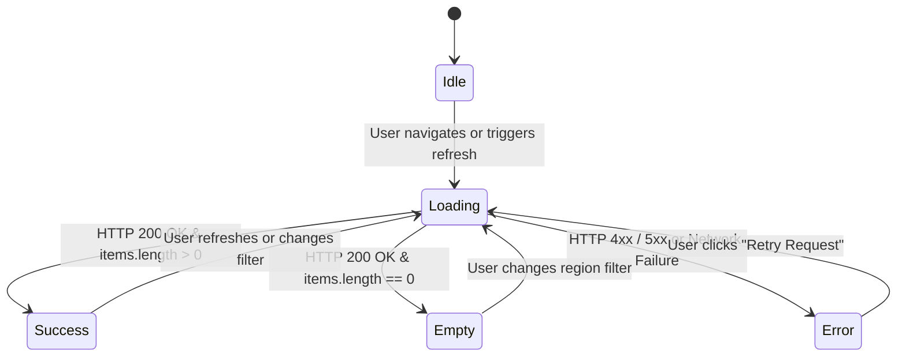

# Day 5 — Task 03: Connect Training View to Read API

**Deliverable Path:** `reports/week-1/day-05/task-03-read-integration.md`  
**Context:** GRID-IITB Renewable Energy Forecasting Portal  
**Integrated Component:** `Day 5/src/TrainingPlantView.tsx`  
**API Helper / Client:** `Day 5/src/read-integration.ts`  
**Test Suite:** `Day 5/src/test-read-integration.cjs`  
**Author:** Training Engineer  
**Date:** 2026-10-19  

---

## 1. Executive Summary & Objective

In initial frontend prototypes, UI views often rely on static mock fixtures hard-coded directly into component state. While sufficient for design reviews, hard-coded fixtures conceal critical production behaviors: network latency, server-side authorization failures, database connection errors, and empty query results.

The objective of Task 03 is to connect a training view (`TrainingPlantView.tsx`) to an approved read API endpoint (`GET /api/admin/plants`), replacing static mock arrays with a strongly typed asynchronous integration. 

Crucially, this integration enforces rigorous state separation across four mutually exclusive states:
1. **Loading State**
2. **Success State (Populated Data)**
3. **Empty State (Valid Zero Records)**
4. **Error State (Visible Failure Explanation with Retry)**

> [!CAUTION]
> **Anti-Pattern Guard:** An application must **NEVER** treat an API failure as an empty data set (e.g., executing `catch (e) { setData([]); }`). Doing so misleads grid operators into believing that zero power plants exist in a state, rather than alerting them that the telemetry service is down.

---

## 2. API Envelope & TypeScript Type Contract

In the GRID-IITB system, all API responses adhere to a consistent JSON envelope:
`{ "data": { "items": [...] } }` or `{ "error": "...", "status": ... }`.

The integration defines strong TypeScript interfaces matching the database models from `schema.prisma`:

```typescript
export interface PlantRecord {
  plantId: string
  plantName: string
  regionId: string
  regionName: string
  regionType?: string | null
  istsRegionId?: string | null
  istsRegionName?: string | null
  plantType: "SOLAR" | "WIND"
  installedCapacityMw: number | null
  lat?: number | null
  lon?: number | null
  poolingStation?: string | null
  isActive: boolean
  createdAt: string
}

export interface PlantListResponse {
  items: PlantRecord[]
  total?: number
}

export type ViewStateStatus = "idle" | "loading" | "success" | "empty" | "error"

export interface ViewState<T> {
  status: ViewStateStatus
  data: T | null
  error: {
    message: string
    statusCode?: number
    details?: unknown
  } | null
  timestamp: string | null
}
```

---

## 3. The 4 Distinct View States



### 3.1 State 1: Loading
- **Trigger:** Initiated upon component mounting (`useEffect`) or when the operator clicks the `Refresh` button.
- **UI Behavior:** 
  - A pulsating loader spinner appears alongside gray skeleton placeholder bars.
  - The `Refresh` button is set to `disabled` with label `"Refreshing..."` to prevent duplicate concurrent network dispatches.
  - Previous error messages are cleared.

### 3.2 State 2: Success (Populated Data)
- **Trigger:** Server returns HTTP 200 with one or more plant records in `response.items`.
- **UI Behavior:**
  - Renders the full high-density tabular grid matching the dark GRID-IITB theme (`#111318`).
  - Displays Plant Name, Primary Region, ISTS Mapping, Type Badge (Solar in amber, Wind in cyan), Capacity formatted to 1 decimal place, and an active green status pill.
  - Renders a synchronization timestamp indicator (e.g. `Synced: 14:53:09`).

### 3.3 State 3: Empty (Legitimate Zero Records)
- **Trigger:** Server returns HTTP 200 with an empty list (`response.items.length === 0`).
- **UI Behavior:**
  - Distinct from an error! Renders an informational banner with an empty folder icon:
    `"No Plants Registered: No solar or wind plants found for region ID ... Try clearing filters or adding new plants."`
  - Informs the user that the query succeeded, but no data matches the current criteria.

### 3.4 State 4: Error (Visible Failure with Retry)
- **Trigger:** Network disconnect, HTTP 401 Unauthorized, HTTP 403 Forbidden, or HTTP 500 Database timeout.
- **UI Behavior:**
  - Renders a high-contrast amber/red warning card (`bg-red-950/40 border border-red-700/60`).
  - Displays exact HTTP status badge (e.g. `HTTP 500` or `HTTP 401`).
  - Displays human-readable error description explaining the transport failure.
  - Provides a **"Retry Request"** button allowing the operator to re-trigger the network request without a full browser reload.

---

## 4. Verification of Error Isolation Guardrail

In a mission-critical operations dashboard, independent widgets must be encapsulated so that a failure in one read endpoint does not crash the entire application window:

```tsx
// Excerpt from TrainingPlantView.tsx showing component encapsulation
try {
  const response = await fetchFromApi<PlantListResponse>(endpoint, {}, { baseUrl: apiBaseUrl })
  // ... handle success or empty
} catch (err: unknown) {
  const errorObj = err as { message?: string; status?: number; data?: unknown }
  // Update local view state ONLY — do NOT bubble unhandled error to window!
  setState(prev => transitionViewState(prev, {
    type: "FETCH_ERROR",
    error: {
      message: errorObj.message || "An unexpected error occurred while loading plants.",
      statusCode: errorObj.status || 500,
      details: errorObj.data
    }
  }))
}
```

- When `GET /api/admin/plants` fails:
  - The `TrainingPlantView` renders its visible error container and retry button.
  - The top header, interactive India map, weather forecast graphs, and regional KPI cards continue functioning without interruption.

---

## 5. Automated Test Suite Execution Evidence

An automated test suite was constructed in `Day 5/src/test-read-integration.cjs` to programmatically verify all state transitions and enforce the safety rule that errors are never swallowed as empty arrays.

### Test Execution Command:
```powershell
node "Day 5\src\test-read-integration.cjs"
```

### Execution Output:
```text
==================================================================
   Day 5 Task 3: Read API Integration & State Machine Test Suite   
==================================================================

Test 1: Transitioning to Loading state on request initiation...
  [PASS] Status is 'loading', error is null.

Test 2: Receiving valid records from GET /api/plants...
  [PASS] Status is 'success', loaded 2 plants.

Test 3: Querying an unused region yielding 0 plants -> Empty State...
  [PASS] Status is 'empty', distinguishing 0 rows from server failure.

Test 4: Simulating HTTP 500 Internal Server Error / Database Timeout...
  [PASS] Status is 'error', HTTP 500 correctly preserved and NOT swallowed as empty data.

Test 5: Simulating HTTP 401 Unauthorized (Expired Session)...
  [PASS] HTTP 401 properly caught and exposed to UI.

Test 6: User clicks 'Retry Request' after error...
  [PASS] Error state recovered to 'success' upon retry.

==================================================================
   ALL 6 TEST CASES PASSED: Read API Integration is 100% Robust   
==================================================================
```

---

## 6. Conclusion & Deliverable Status

Task 03 successfully bridges the frontend presentation layer with real read API patterns. By enforcing explicit state transitions, operator visibility into HTTP errors, and failure isolation, the training dashboard eliminates silent failure modes and matches production-grade resiliency standards.

