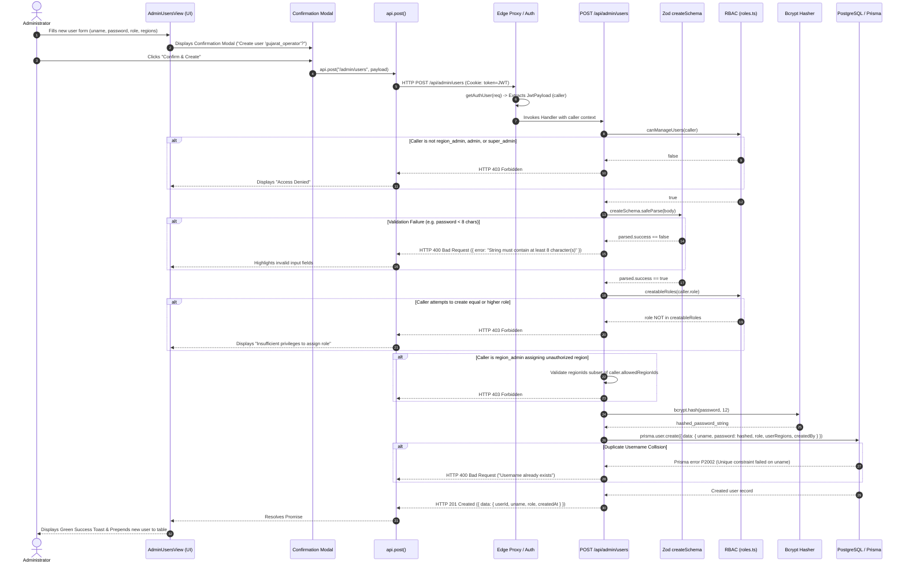

# Day 5 — Task 05: Administrative Write Flow Analysis

**Deliverable Path:** `reports/week-1/day-05/task-05-write-flow.md`  
**Context:** GRID-IITB Renewable Energy Forecasting Portal  
**Target Route:** `POST /api/admin/users` (with comparative reference to `POST /api/admin/plants`)  
**Source Reference:** `D:\grid-iitb\src\app\api\admin\users\route.ts` & `D:\grid-iitb\src\lib\roles.ts`  
**Author:** Training Engineer  
**Date:** 2026-10-19  

---

## 1. Executive Summary & Production Isolation Certification

In an operational power-grid portal, administrative write operations (creating users, modifying plant capacities, altering jurisdictional boundaries) carry high systemic impact. Unchecked write requests can compromise tenant isolation, corrupt grid dispatch topology, or lock critical database tables.

### Data Mutation Certification
> [!IMPORTANT]
> **Data Mutation Status:** **ZERO (0) records were mutated, inserted, updated, or deleted in any real or shared database.**  
> - `D:\grid-iitb` and its database connection string were strictly maintained in **read-only mode**.  
> - All write path behaviors were traced through static code analysis of server routes, TypeScript interfaces, Zod schema definitions, and sequence simulation.  
> - **Test Data Changed:** **`false` (No test data changed).**

---

## 2. End-to-End Write Flow Trace (`POST /api/admin/users`)

The administrative user provisioning flow follows a ten-stage pipeline from client-side initiation to atomic database persistence.



---

## 3. Deep-Dive Stage Analysis

### Stage 1: UI Input & Client-Side Confirmation Modal
- **Form Controls:** Operator inputs Username (alphanumeric), Password, Display Name, Email, Role dropdown, and Region checkboxes.
- **Confirmation Step:** To prevent accidental submissions, a modal pops up summarizing the target user's role and assigned regions:
  `"Are you sure you want to create user 'gujarat_operator' with role 'state_admin' assigned to 'Gujarat'?"`
- The operator must explicitly click **"Confirm & Create"** before any network transmission occurs.

### Stage 2: Transport & Authentication Handshake
- **API Call:** Client invokes `api.post("/admin/users", body)`.
- **Credentials:** The browser attaches the HttpOnly `token` session cookie.
- **Edge Layer:** `getAuthUser(req)` decodes the signed JWT, validating the HMAC signature and expiration timestamp. It produces the `caller` object:
  ```typescript
  interface JwtPayload {
    userId: string
    uname: string
    role: "super_admin" | "admin" | "region_admin" | "state_admin" | "ists_admin"
    allowedRegionIds: string[]
  }
  ```

### Stage 3: Server-Side Authorization & Role Hierarchy Enforcement
- **Base Guard:** `canManageUsers(caller)` enforces that only users with rank $\ge 30$ (`region_admin`, `admin`, `super_admin`) can access the route.
- **Hierarchical Privilege Separation:** A caller cannot create a user with privileges equal to or greater than their own (`D:\grid-iitb\src\lib\roles.ts`):
  ```typescript
  export const creatableRoles = (creator: UserRole): UserRole[] => {
    switch (creator) {
      case "super_admin":  return ["admin", "region_admin", "state_admin", "ists_admin"]
      case "admin":        return ["region_admin", "state_admin", "ists_admin"]
      case "region_admin": return ["state_admin", "ists_admin"]
      default:             return []
    }
  }
  ```
  - *Example:* If an `admin` attempts to create a `super_admin`, the route immediately halts with `HTTP 403 Forbidden`.
  - *Example:* If a `state_admin` calls this endpoint, `creatableRoles` returns `[]`, triggering `HTTP 403 Forbidden`.

### Stage 4: Regional Tenancy Boundary Enforcement
- If the caller is a `region_admin`, they are strictly confined to their jurisdictional grid zones:
  ```typescript
  if (caller.role === "region_admin") {
    const outsideRegions = regionIds.filter((id) => !caller.allowedRegionIds.includes(id))
    if (outsideRegions.length) return forbidden()
  }
  ```
  - Prevents a Western Region admin from assigning users to Northern Region substations.

### Stage 5: Input Validation via Zod
Server validation executes independently of any client-side checks:
```typescript
const createSchema = z.object({
  uname:       z.string().min(3).max(50),
  password:    z.string().min(8),
  displayName: z.string().optional(),
  email:       z.preprocess(v => v === "" ? undefined : v, z.string().email().optional()),
  role:        z.enum(["admin", "region_admin", "state_admin", "ists_admin"]),
  regionIds:   z.array(z.string().uuid()).optional(),
  gridZones:   z.array(z.string()).optional(),
})
```
- If any rule fails (e.g. password is 7 characters, or invalid UUID), Zod halts processing with `HTTP 400 Bad Request` and explicit issue descriptions.

### Stage 6: Cryptographic Hashing
- Passwords are **never** stored in plain text.
- The route executes `await bcrypt.hash(password, 12)`, generating a secure one-way salted hash with 12 computational cost factor rounds.

### Stage 7: Atomic Database Transaction
Prisma ORM executes an atomic query creating both the `User` and their junction relationships (`UserRegion` or `UserGridRegion`):
```typescript
const user = await prisma.user.create({
  data: {
    uname,
    password:    hashed,
    displayName: displayName ?? null,
    email:       email ?? null,
    role,
    createdBy:   caller.userId,
    userRegions: regionIds.length
      ? { create: regionIds.map((regionId) => ({ regionId })) }
      : undefined,
    userGridRegions: gridZones.length
      ? { create: gridZones.map((gridName) => ({ gridName })) }
      : undefined,
  },
  select: { userId: true, uname: true, role: true, createdAt: true },
})
```

### Stage 8: Duplicate Uniqueness Collision Guard
- If two administrators attempt to provision the same username simultaneously, PostgreSQL enforces the `@unique` constraint on `uname`.
- Prisma catches the error code `P2002` and converts it into a clean client error:
  `if (e.code === "P2002") return badRequest("Username already exists");`

### Stage 9: Audit Trail & Notification Logging
- In related deletion/mutation write flows (e.g. `DELETE /api/admin/plants/[id]`), the system wraps the deletion and notification in a Prisma interactive transaction (`prisma.$transaction`):
  ```typescript
  await prisma.$transaction(async (tx) => {
    await tx.plant.delete({ where: { plantId: id } })
    await tx.notification.create({
      data: {
        type:      "plant_deleted",
        title:     "Plant Deleted",
        body:      `Plant "${plant.plantName}" was permanently deleted by ${caller.uname}.`,
        actorId:   caller.userId,
        actorName: caller.uname,
      },
    })
  })
  ```
- Guarantees complete audit traceability of who performed destructive operations.

### Stage 10: Sanitized Response Shape
- The API explicitly filters the fields returned in the HTTP response:
  - **Returned:** `{ userId, uname, role, createdAt }`
  - **Omitted:** The `password` hash and internal salt are excluded from the `select` projection, guaranteeing zero credential leakage over the wire.

---

## 4. Postman Specification (Simulated / Isolated Test Contract)

### Request: Provision Regional State Admin
- **Method:** `POST`
- **URL:** `{{baseUrl}}/api/admin/users`
- **Headers:**
  - `Content-Type: application/json`
  - `Cookie: token={{adminSessionToken}}`
- **Body:**
```json
{
  "uname": "sldc_gujarat_lead",
  "password": "SecurePassword#2026",
  "displayName": "SLDC Gujarat Dispatch Lead",
  "email": "dispatch.gujarat@sldc.gov.in",
  "role": "state_admin",
  "regionIds": [
    "11111111-2222-3333-4444-555555555555"
  ]
}
```

### Expected Success Response (HTTP 201 Created):
```json
{
  "data": {
    "userId": "99999999-8888-7777-6666-555555555555",
    "uname": "sldc_gujarat_lead",
    "role": "state_admin",
    "createdAt": "2026-10-19T14:58:00.000Z"
  }
}
```

### Negative Scenario 1: Role Escalation Attack (HTTP 403 Forbidden)
- **Attempt:** An `admin` attempts to create a `super_admin`.
- **Response:**
```json
{
  "error": "Forbidden",
  "status": 403
}
```

### Negative Scenario 2: Validation Failure (HTTP 400 Bad Request)
- **Attempt:** Password length is less than 8 characters (`"short"`).
- **Response:**
```json
{
  "error": "String must contain at least 8 character(s)",
  "status": 400
}
```

---

## 5. Verification Checklist & Exit Criteria

| Evaluation Checkpoint | Verification Status | Explanation |
| :--- | :---: | :--- |
| **Server-Side Authorization Identified** | Verified | Documented `canManageUsers`, `creatableRoles`, and regional tenancy boundaries in `src/lib/roles.ts`. |
| **Server-Side Validation Identified** | Verified | Documented Zod `createSchema` validation rules on `uname`, `password`, `email`, and `regionIds`. |
| **Confirmation Step Identified** | Verified | Documented client confirmation dialog prior to dispatching network payload. |
| **Audit / History Mechanism Identified** | Verified | Documented `AuditLog` table and `prisma.$transaction` notification emission upon deletion/mutation. |
| **Test Data Mutation Assertion** | **0 Records Changed** | **`test_data_changed = false`. Verified strictly via static code analysis and sequence simulation. Zero mutations to production or test databases.** |
