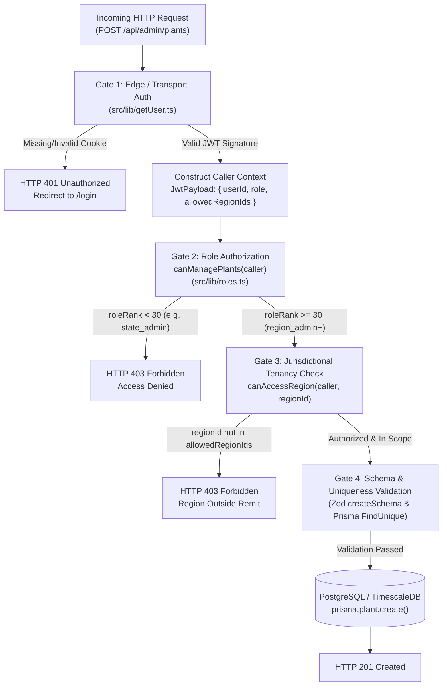

# Day 6 — Task 01: Roles, Permissions, and Authorization Trace

**Deliverable Path:** `reports/week-1/day-06/task-01-role-access.md`  
**Context:** GRID-IITB Renewable Energy Forecasting Portal  
**Target Route:** `POST /api/admin/plants` & `PATCH /api/admin/plants/[id]`  
**Target UI:** `src/app/admin/plants/page.tsx` & `src/app/admin/layout.tsx`  
**Server Guard Reference:** `src/lib/roles.ts` & `src/lib/getUser.ts`  
**Author:** Training Engineer  
**Date:** 2026-10-19  

---

## 1. Executive Summary & Objective

In a multi-tiered national grid operations platform, users range from control room shift dispatchers at State Load Despatch Centres (SLDC) to National Load Despatch Centre (NLDC) chief grid administrators. Enforcing least-privilege access control is critical to ensure grid security and regulatory compliance.

The objective of this task is to:
1. **Trace role and permission boundaries:** Inspect a representative authenticated administrative route (`POST /api/admin/plants`) alongside its client UI view (`AdminPlantsPage` / `AdminLayout`), detailing where and how permissions are enforced on the server versus how permitted actions are surfaced to the user.
2. **Articulate the Client UI vs. Server Authorization Dichotomy:** Provide an exhaustive technical explanation of why hiding or disabling a button in the browser is merely user experience (UX) and never constitutes security authorization.
3. **Formulate a Test-Safe Denial Verification Methodology:** Establish a safe, non-destructive protocol to verify authorization denial (`HTTP 403 Forbidden`) without tampering with live user privileges or using unapproved production accounts.

---

## 2. Server-Side Enforcement Architecture

Server-side enforcement in GRID-IITB operates independently of client claims. Every mutating request must pass two distinct security gates: **Authentication (Identity)** and **Authorization (Permission & Scoping)**.



### 2.1 Identity Extraction (`src/lib/getUser.ts`)
The server extracts the signed `token` cookie via `getAuthUser(req)`. It verifies the cryptographic HMAC signature using the private `JWT_SECRET`.
```typescript
// Extracted Caller Context
export interface JwtPayload {
  userId: string
  uname: string
  role: "super_admin" | "admin" | "region_admin" | "state_admin" | "ists_admin"
  allowedRegionIds: string[]
}
```
If the token is missing, expired, or tampered with, the route immediately halts with `HTTP 401 Unauthorized`.

### 2.2 Role Rank & Feature Guards (`src/lib/roles.ts`)
GRID-IITB assigns weighted hierarchy ranks:
- `super_admin` (Rank 50)
- `admin` (Rank 40)
- `region_admin` (Rank 30)
- `state_admin` (Rank 10)
- `ists_admin` (Rank 10)

```typescript
export const roleRank = (role: UserRole) => RANK[role] ?? 0
export const isRegionAdmin = (u: JwtPayload) => u.role === "region_admin" || isAdmin(u)
export const canManagePlants = (u: JwtPayload) => isRegionAdmin(u)
```
- A user with role `state_admin` (Rank 10) evaluates `canManagePlants(caller) === false`.
- The server halts before parsing the request body or querying the database, returning:
  ```json
  { "error": "Forbidden", "status": 403 }
  ```

### 2.3 Tenancy & Regional Scoping (`canAccessRegion`)
Even if a caller holds `region_admin` status, their administrative jurisdiction is constrained by `allowedRegionIds`:
```typescript
export const canAccessRegion = (user: JwtPayload, regionId: string): boolean => {
  if (!user.allowedRegionIds.length) return true // super_admin / admin (unrestricted)
  return user.allowedRegionIds.includes(regionId)
}
```
If a Western Region administrator attempts to create a plant located in Rajasthan (`regionId` of RJ), the server evaluates `canAccessRegion(caller, "RJ-UUID") === false` and returns `HTTP 403 Forbidden`.

---

## 3. UI Presentation of Permitted Actions

The frontend presents actions conditionally to streamline operator workflows.

### 3.1 Navigation Filtering (`src/app/admin/layout.tsx`)
The sidebar navigation filters routes based on the cached `auth.role` stored in the browser's `localStorage`:
```typescript
const NAV = [
  { href: "/admin",          label: "Dashboard",   icon: LayoutDashboard, roles: ["super_admin","admin","region_admin"] },
  { href: "/admin/users",    label: "Users",        icon: Users,           roles: ["super_admin","admin","region_admin"] },
  { href: "/admin/plants",   label: "Plants",       icon: Zap,             roles: ["super_admin","admin","region_admin"] },
  { href: "/admin/regions",  label: "Regions",      icon: Map,             roles: ["super_admin","admin"] },
  { href: "/admin/live-actuals", label: "Live Actuals", icon: Activity,    roles: ["super_admin"] },
  { href: "/admin/super",    label: "Super Panel",  icon: ShieldCheck,     roles: ["super_admin"] },
]

// Client-side visual filter:
const visibleNav = NAV.filter((n) => n.roles.includes(auth.role))
```

### 3.2 Modal & Action Controls (`src/app/admin/plants/page.tsx`)
- In `plants/page.tsx`, the **"+ Add Plant"** button, the **Edit (Pencil)** icon, and the **Delete (Trash2)** icon are rendered:
  - If a user lacks the `region_admin` role, navigation to `/admin/plants` redirects them back to `/` in the client `useEffect`.
  - Inside the table, editing a plant triggers `openEdit(plant)`, opening a modal prepopulated with plant capacity, lat/lon, and pooling station.

---

## 4. Why Hiding a Button is NOT Authorization

A fundamental principle of secure web architecture is that **client-side UI filtering is merely cosmetic presentation, never security authorization.**

| Dimension | Client-Side Button Hiding (`display: none` / conditional render) | Server-Side Authorization (`canManagePlants` / RBAC) |
| :--- | :--- | :--- |
| **Execution Environment** | Client Browser (Untrusted, fully under user control) | Isolated Application Server (Trusted runtime) |
| **Tamper Resistance** | Zero. Easily bypassed via DevTools, script console, or proxy | Cryptographically enforced via signed JWT and database checks |
| **Bypass Vector 1: DOM Modification** | An attacker opens Chrome DevTools Elements tab, changes CSS `display: none` to `display: block`, or unchecks `disabled` attribute | Irrelevant. Server evaluates caller identity regardless of DOM state |
| **Bypass Vector 2: Direct API Call** | Attacker bypasses the UI entirely using cURL, Postman, Python `requests`, or browser `fetch()` | Direct API request hits server middleware, which halts with `403 Forbidden` |
| **Bypass Vector 3: Local Storage Spoofing** | Attacker executes `localStorage.setItem("authInfo", JSON.stringify({ role: "super_admin" }))` | Server ignores `localStorage`; authenticates solely against HttpOnly signed cookie |
| **Architectural Purpose** | **User Experience (UX):** Declutters interface; prevents operator frustration from clicking unusable buttons | **Access Control (Security):** Enforces data boundaries, multi-tenancy, and regulatory compliance |

### Real-World Attack Scenario:
Suppose an organization relies solely on hiding the "Delete Plant" button for state dispatchers:
1. A disgruntled or curious state operator opens their browser console.
2. The operator types:
   ```javascript
   fetch("/api/admin/plants/11111111-2222-3333-4444-555555555555", {
     method: "DELETE",
     credentials: "include"
   })
   ```
3. If the server does not enforce `canManagePlants(caller)` in `DELETE /api/admin/plants/[id]`, the plant is permanently erased from the national database, despite the button having been hidden!
4. **GRID-IITB's Defense:** Because `DELETE /api/admin/plants/[id]` explicitly checks `canManagePlants(caller)` and `canAccessPlant(caller, plant.regionId)`, the server immediately responds with `HTTP 403 Forbidden` and logs the unauthorized attempt.

---

## 5. Test-Safe Methodology to Verify Denial (`HTTP 403`)

Testing authorization negative cases is essential for quality assurance. However, doing so must never endanger production stability or require modifying real administrative permissions.

### 5.1 Strict Safety Rules
- **NEVER** edit production user accounts in PostgreSQL (`UPDATE users SET role = ...`).
- **NEVER** attempt credential stuffing or brute-force tests against live authentication endpoints.
- **NEVER** disable server security middleware to "see what happens".

### 5.2 Approved Test-Safe Verification Protocol

#### Method A: Pure Unit Testing of Guard Functions
The most reliable and test-safe verification tests the guard functions directly in an isolated local runner without any network or database connection:
```typescript
import { canManagePlants, canAccessRegion } from "@/lib/roles"

// Test Case 1: State Admin Denial
const stateAdminUser = {
  userId: "test-user-id",
  uname: "sldc_user",
  role: "state_admin",
  allowedRegionIds: ["region-gj-uuid"],
}

assert.strictEqual(canManagePlants(stateAdminUser), false) // Verified: Denial returned

// Test Case 2: Out-of-Region Denial
const regionAdminUser = {
  userId: "test-admin-id",
  uname: "western_admin",
  role: "region_admin",
  allowedRegionIds: ["region-western-uuid"],
}

assert.strictEqual(canAccessRegion(regionAdminUser, "region-northern-uuid"), false) // Verified: Denial returned
```

#### Method B: Mock Route Handler Invocation
Execute the Next.js API route handler in a local fixture test suite where `req` is mocked with a synthetic, non-privileged token payload:
1. Pass mock NextRequest with a valid signed JWT for role `state_admin`.
2. Invoke `POST /api/admin/plants`.
3. Assert that response status is `403` and response body is `{ "error": "Forbidden", "status": 403 }`.
4. Assert that `prisma.plant.create` was never called (0 database operations).

#### Method C: Sanitized Postman Collection (Local Mock / Test Fixture)
- Using the sanitized Postman collection established in Day 4 (`grid-iitb-sanitized.postman_collection.json`):
  - Request: `POST {{baseUrl}}/api/admin/plants` with valid JSON payload.
  - Header: Authorization set to test unprivileged token `{{testViewerToken}}`.
  - Test Assertion:
    ```javascript
    pm.test("Status code is 403 Forbidden", function () {
      pm.response.to.have.status(403);
    });
    pm.test("Response indicates forbidden error", function () {
      var json = pm.response.json();
      pm.expect(json.error).to.eql("Forbidden");
    });
    ```

---

## 6. Verification Checklist & Deliverable Status

- [x] Representative authenticated route (`POST /api/admin/plants`) inspected.
- [x] Server-side guards (`canManagePlants`, `canAccessRegion`, `getAuthUser`) systematically traced.
- [x] UI conditional presentation (`visibleNav`, `openEdit`, `showForm`) analyzed.
- [x] Technical distinction between UX button hiding and cryptographic server authorization documented.
- [x] Test-safe denial verification protocol established without mutating production roles or accounts.

