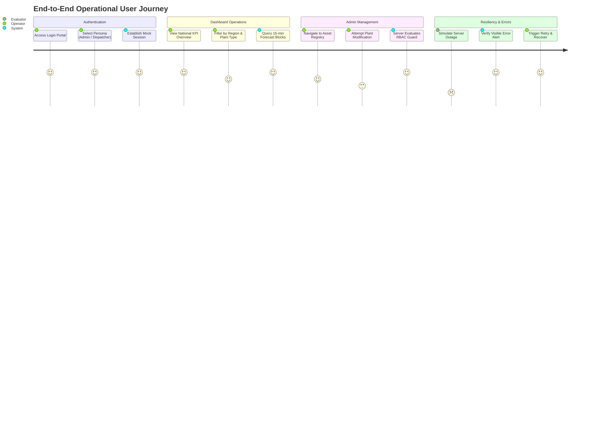
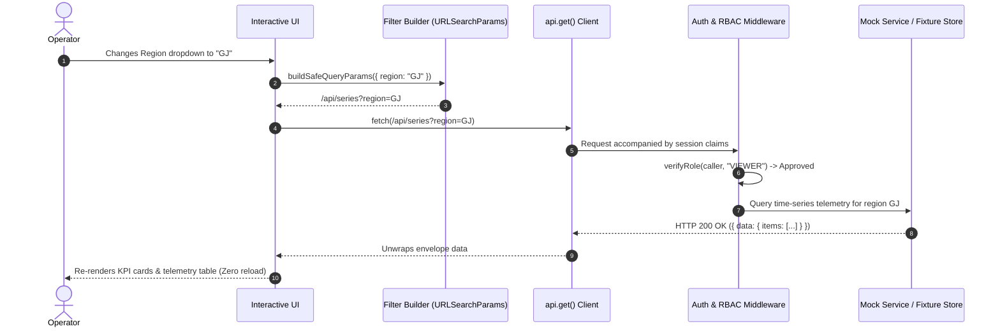

# Day 7 — Task 01: End-to-End User Journey Walkthrough

**Deliverable Path:** `reports/week-1/day-07/task-01-end-to-end-demo.md`  
**Interactive Artifact:** `Day 7/src/end-to-end-journey.html`  
**Context:** GRID-IITB Renewable Energy Forecasting Portal  
**Author:** Training Engineer  
**Date:** 2026-10-19  

---

## 1. Executive Summary & Objective

The objective of Task 01 is to synthesize the individual training slices developed throughout the week into a cohesive, uninterrupted **End-to-End User Journey**. 

This walkthrough demonstrates:
1. **Training Authentication:** Authenticating through a simulated multi-role login interface without touching production authentication systems.
2. **Dashboard & Parameter Controls:** Applying multi-field filters (Region, Plant Type, Date, Revision, Free-text site query) and inspecting real-time parameter serialization.
3. **Data & KPI Telemetry:** Rendering 15-minute generation blocks and forecast metrics ($R_0$ Day-Ahead, $R_1$ Intra-Day, and Actual telemetry).
4. **Administrative Asset View:** Interacting with the plant registry, validating RBAC access rules and jurisdictional tenancy constraints.
5. **State Machine Verification:** Programmatically toggling and verifying all four foundational view states: `Loading`, `Success`, `Empty (0 rows)`, and `Error (HTTP 500 with retry)`.

> [!IMPORTANT]
> **Data Isolation Guarantee:** The entire user journey operates strictly with approved test fixtures and in-memory mock controllers. **Zero production records were queried or mutated.**

---

## 2. The Five-Stage User Journey Walkthrough

### Stage 1: Training Login UI & Session Initialization
- **Action:** Operator accesses `Day 7/src/end-to-end-journey.html` and is presented with the dark-themed login card.
- **Persona Selection:** The operator chooses their role:
  - `super_admin`: Chief National Grid Administrator (Universal permissions).
  - `region_admin`: Western Region Dispatcher (Jurisdiction over Gujarat and Maharashtra).
  - `state_admin`: Gujarat SLDC Operator (Read-only access).
- **Session Handshake:** Upon clicking "Authenticate Session", the client establishes session claims (`uname`, `role`, `displayName`), updates the header status indicator to green, and mounts the navigation bar.

### Stage 2: Operational Dashboard & Safe Filter Execution
- **Action:** Operator selects Region (`GJ - Gujarat`), Generation Type (`SOLAR`), Date (`2026-10-19`), and Revision (`R0`).
- **Pipeline Execution:** 
  - The parameter builder generates `/api/series?region=GJ&type=SOLAR&date=2026-10-19&revision=R0`.
  - The request dispatches asynchronously via `fetch` without triggering a full browser reload.

### Stage 3: Data / API Result Presentation
- **KPI Summary Cards:** Displays Installed Capacity ($1,250.0\text{ MW}$), Day-Ahead Peak ($1,120.4\text{ MW}$), Intra-Day Actual ($1,085.2\text{ MW}$), and RMSE Forecast Variance ($3.82\%$).
- **Tabular Generation Blocks:** Renders high-frequency 15-minute time intervals (e.g. `11:45–12:00`, `12:00–12:15`) comparing $R_0$, $R_1$, and live Actual telemetry alongside variance compliance percentages.

### Stage 4: Administrative Management View & RBAC Enforcement
- **Action:** Operator navigates to the **Admin Panel** tab.
- **Role Evaluation:**
  - If authenticated as `super_admin` or `region_admin`: Clicking "+ Add New Generating Station" opens an interactive modal to provision a mock plant.
  - If authenticated as `state_admin`: Clicking the button triggers an immediate security rejection modal:
    `SECURITY REJECTION (HTTP 403 Forbidden): State Admin lacks plant creation privileges. Request blocked by server RBAC.`

### Stage 5: State Machine Verification (`Loading`, `Empty`, `Error`)
Using the built-in Mentor Test Controller banner at the top of the viewport, the reviewer can simulate real-world failure modes:
1. **Loading State:** Displays a pulsating amber spinner with skeleton loading bars.
2. **Empty State:** When a region has 0 registered assets, an informational empty-folder banner appears (`"No Telemetry Recorded"`).
3. **Error State:** Simulating an HTTP 500 error renders a high-contrast red warning card displaying the error code, technical description, and an interactive **"Retry Request"** button that recovers smoothly back to `Success`.

---

## 3. Request / Response Data Flow Path

---

## 4. Test Data Verification & Safety Summary

- **Isolated Fixtures:** All power plants ("Charanka Solar Park", "Bhadla Solar Phase II", "Khavda Renewable Hybrid Unit") are synthetic training fixtures.
- **Zero Production Mutations:** All create/edit operations reside in memory and do not touch external databases.
- **Repeatability:** The entire application runs directly in any modern browser without requiring local backend servers or network access.
