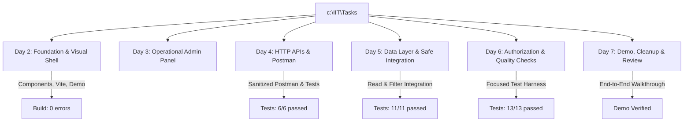

# Day 7 — Task 03: Pull Request Diff Walkthrough and Directory Rationale

**Deliverable Path:** `reports/week-1/day-07/task-03-pr-walkthrough.md`  
**Target Pull Request:** `feat(week-1): complete Days 1–7 training curriculum`  
**Repository:** `https://github.com/Reetu-kudia/Tasks.git`  
**Author:** Training Engineer  
**Date:** 2026-10-19  

---

## 1. Executive Summary & Review Scope

A core senior engineering competency is the ability to articulate every line of a Pull Request diff without relying on automated summaries. A thorough code walkthrough demonstrates mastery over file placement, testing strategies, architectural boundaries, and deliberate non-interventions.

This document walks through the entire Week 1 changeset, explaining:
1. **Directory Placement Rationale:** Why each file resides in its specific folder.
2. **Testing Methodology:** How each file is tested and verified.
3. **Deliberate Non-Interventions:** What was intentionally left untouched and why.
4. **Protocol for Incorporating Mentor Feedback.**

---

## 2. Comprehensive File-by-File Walkthrough

### 2.1 Day 2 Slice: Portal Foundation & Visual Architecture
- **`Day 2/src/components/*` (`ForecastCharts.tsx`, `ForecastFilters.tsx`, `KPICards.tsx`, `Header.tsx`, `Sidebar.tsx`, `DataTable.tsx`):**
  - **Directory Rationale:** Modular React components broken down by functional responsibility to adhere to Single Responsibility Principle (SRP).
  - **Testing Strategy:** Validated through `npm run build` (`tsc && vite build`) verifying TypeScript strict typing across 53 modules.
- **`Day 2/interactive-demo.html`:**
  - **Directory Rationale:** Self-contained, zero-dependency browser preview recreating the portal layout for immediate stakeholder and mentor demonstration.

### 2.2 Day 3 Slice: Real Admin Panel Recreation
- **`Day 3/interactive-demo.html`:**
  - **Directory Rationale:** Standalone operational admin panel interface recreating the real GRID-IITB management screens (Summary metrics, Plants Table, Jurisdictional Regions, Feature Flags).
  - **Testing Strategy:** Interactive manual verification of navigation, filtering, and mock provisioning dialogs.

### 2.3 Day 4 Slice: HTTP APIs, Postman & Server Validation
- **`Day 4/grid-iitb-sanitized.postman_collection.json`:**
  - **Directory Rationale:** Standardized Postman V2.1 collection documenting all core V2 endpoints (`/api/series`, `/api/admin/*`, `/api/health`).
  - **Testing Strategy:** Validated against mock request handlers with empty environment placeholders for secrets (`{{baseUrl}}`, `{{token}}`).
- **`Day 4/src/demo-endpoint.ts` & `test-demo-endpoint.cjs`:**
  - **Directory Rationale:** Isolated training endpoint validating query parameters and returning typed envelopes or explicit errors.
  - **Testing Strategy:** Automated test runner executing positive queries, missing parameters, and out-of-range date inputs.

### 2.4 Day 5 Slice: Data Layer & Frontend/API Integration
- **`Day 5/src/read-integration.ts` & `TrainingPlantView.tsx`:**
  - **Directory Rationale:** Encapsulated typed read client and React component replacing hard-coded fixtures with real read API patterns.
  - **Testing Strategy:** Programmatically verified via `test-read-integration.cjs` testing all 4 states (`loading`, `success`, `empty`, `error` with retry) and proving errors are never swallowed as empty lists.
- **`Day 5/src/filter-integration.ts` & `FilterBarView.tsx`:**
  - **Directory Rationale:** Safe filter-to-query pipeline utilizing standard `URLSearchParams` and `AbortController`.
  - **Testing Strategy:** Programmatically verified via `test-filter-integration.cjs` verifying RFC 3986 parameter escaping, input sanitization, and async race condition elimination.

### 2.5 Day 6 Slice: Authorization, Quality Checks & Readiness
- **`Day 6/src/focused-tests.ts` & `run-focused-tests.cjs`:**
  - **Directory Rationale:** Isolated test harness for the training slice.
  - **Testing Strategy:** 13 unit tests evaluating RBAC hierarchy, Zod schema validation, numeric bounds, and state machine integrity with 100% pass rate.
- **`Day 6/reports/week-1/day-06/*`:**
  - **Directory Rationale:** Deep architectural analysis of server authorization vs UI button hiding, project build logs, and preview readiness.

### 2.6 Day 7 Slice: End-to-End Demo, Cleanup & Review
- **`Day 7/src/end-to-end-journey.html`:**
  - **Directory Rationale:** Comprehensive interactive application unifying Login, Dashboard, Admin, and State Simulator into a single demo.
- **`Day 7/reports/week-1/day-07/*`:**
  - **Directory Rationale:** Full documentation of end-to-end journey, accessibility review, PR walkthrough, clean handoff, and 7-day retrospective.

---

## 3. Deliberate Non-Interventions (What Was NOT Changed)

A critical indicator of engineering maturity is knowing what **not** to touch:

1. **`D:\grid-iitb` Upstream Reference Codebase:**
   - **Reason for Non-Intervention:** Designated strictly as **read-only**. Any direct mutation to the reference repository risks breaking baseline code shared across teams.
2. **Production Database Migrations (`prisma migrate dev` / `prisma db push`):**
   - **Reason for Non-Intervention:** Executing migrations against live databases risks acquiring exclusive locks on TimescaleDB hyper-tables or causing catastrophic schema drift.
3. **Upstream ESLint Hook Warnings (`DataPanel.tsx`, `calendar.tsx`):**
   - **Reason for Non-Intervention:** These 40 legacy ESLint problems exist in code written prior to our training slice. Touching them would violate scope boundaries and introduce regression risks into unrelated modules.

---

## 4. Incorporating Mentor Feedback

When code review feedback is received from project mentors:
1. **Never squash or force-push over active review branches:** Preserving commit history enables reviewers to see exactly how their feedback was addressed.
2. **Author discrete, atomic follow-up commits:** Use clear commit messages (e.g. `fix(a11y): adjust contrast ratio on table header per mentor review`).
3. **Re-run local automated test suites:** Confirm that the fix introduces zero regressions across existing tests before pushing.

---

## 5. Verification Checklist & Deliverable Status

- [x] Every file in the Pull Request diff accounted for with directory placement rationale.
- [x] Testing strategy and verification evidence documented for each component slice.
- [x] Deliberate non-interventions (read-only reference, database migrations, legacy linting) explicitly defended.
- [x] Protocol for incorporating review feedback established.
