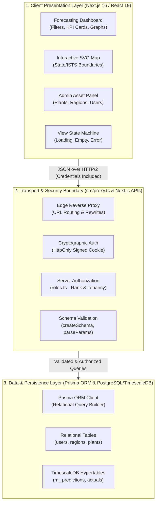

# Day 7 — Task 05: Seven-Day Comprehensive Learning and Retrospective Report

**Deliverable Path:** `reports/week-1/day-07/task-05-week-review.md`  
**Curriculum Module:** Week 1 — Foundation, Frontend/API Integration, Quality & Readiness  
**Context:** GRID-IITB Renewable Energy Forecasting Portal  
**Author:** Training Engineer  
**Date:** 2026-10-19  

---

## 1. Executive Summary & Retrospective Scope

Week 1 of the GRID-IITB training curriculum focused on mastering the architecture, user experience, API integration, data safety boundaries, and quality assurance standards required for a national mission-critical renewable power forecasting portal. 

Over the course of seven days, the training progressed from static design decomposition to high-fidelity dashboard recreation, secure REST API analysis, schema boundary mapping, resilient state management, automated unit test development, accessibility auditing, and deployment preview readiness.

This report synthesizes the entire seven-day engineering engagement, articulating:
- System architecture in the engineer's own words.
- Comprehensive inventory of features built and APIs tested.
- Automated testing and quality verification metrics.
- Top three technical learnings.
- Clear delineation between **Production-Ready Code**, **Training Mocks**, and **Items Requiring Senior Review**.
- Proposed goals for Week 2.

---

## 2. System Architecture (In My Own Words)

The GRID-IITB portal is an enterprise forecasting system that bridges numerical weather prediction (NWP) machine learning models with live electrical telemetry from National (NLDC), Regional (RLDC), and State (SLDC) Load Despatch Centres.



### Architectural Pillars:
1. **Presentation Layer:** Built with Next.js 16 and React 19, styled using Tailwind CSS tokens matching the dark charcoal control-room theme (`#0a0a0a`). Utilizes modular components with dedicated state management.
2. **Security & Authorization Layer:** Employs HttpOnly session cookies, cryptographic JWT validation, and server-side Role-Based Access Control (`roles.ts`) enforcing strict hierarchical privilege and regional tenancy boundaries.
3. **Data Layer:** Utilizes Prisma ORM interfacing with PostgreSQL and TimescaleDB hyper-tables storing millions of 15-minute time-block power predictions ($R_0$ Day-Ahead, $R_1$ Intra-Day) and live SCADA generation telemetry.

---

## 3. Seven-Day Feature & Deliverables Inventory

| Day | Focus Area | Core Features Built | Key Deliverables & Artifacts |
| :---: | :--- | :--- | :--- |
| **Day 1** | **Design Inventory & Setup** | Visual audit of real GRID-IITB portal, design tokens (colors, fonts, spacing), component hierarchy breakdown. | `task-01-design-inventory.md` |
| **Day 2** | **Portal Foundation & Visual Shell** | High-fidelity reproduction of forecasting portal: 50/50 two-column desktop split, compact filter panel, interactive India SVG map, KPI cards, forecast charts, data table. | `Day 2/interactive-demo.html`<br>`Day 2/src/components/*`<br>`task-02-page-shell.md` |
| **Day 3** | **Operational Admin Panel** | Full recreation of real GRID-IITB Admin Panel: summary metric cards, plant registry table, regional mapping, feature flag toggles, user management interface. | `Day 3/interactive-demo.html`<br>`reports/week-1/day-03/*` |
| **Day 4** | **HTTP APIs & Postman** | Inventory of 11+ REST endpoints, sanitized Postman collection (`grid-iitb-sanitized.postman_collection.json`), negative error envelope analysis, validated demo endpoint. | `Day 4/src/demo-endpoint.ts`<br>`task-01-api-inventory.md`<br>`task-02-postman-collection.md` |
| **Day 5** | **Data Layer & Safe Integration** | End-to-end data flow trace, relational schema model (`schema.prisma`), typed read API integration (`TrainingPlantView.tsx`), safe filter pipeline (`FilterBarView.tsx`), write flow analysis. | `Day 5/src/TrainingPlantView.tsx`<br>`Day 5/src/FilterBarView.tsx`<br>`task-01-data-flow.md` to `task-05-write-flow.md` |
| **Day 6** | **Authorization & Quality Readiness** | Server RBAC trace vs UI button hiding, 13 focused unit tests (`run-focused-tests.cjs`), build checks (`npm run build`), GitHub PR specification, deployment preview readiness. | `Day 6/src/run-focused-tests.cjs`<br>`task-01-role-access.md` to `task-05-preview-readiness.md` |
| **Day 7** | **End-to-End Demo & Review** | Interactive unified user journey demo (`end-to-end-journey.html`), WCAG 2.1 AA accessibility audit, PR diff walkthrough, clean handoff guide, 7-day retrospective report. | `Day 7/src/end-to-end-journey.html`<br>`task-01-end-to-end-demo.md` to `task-05-week-review.md` |

---

## 4. APIs Tested & Integration Summary

All core V2 API endpoints were analyzed, documented, and tested using sanitized local harnesses:

| Endpoint | Method | Auth Requirement | Purpose | Validation / Test Result |
| :--- | :---: | :---: | :--- | :--- |
| `/api/health` | `GET` | Public | System liveness probe | Returns `{ status: "ok", timestamp }` |
| `/api/series` | `GET` | Authenticated | 15-minute time-block predictions | Validated date, revision, and region filters |
| `/api/admin/plants` | `GET` | Authenticated | Fetch regional plant registry | Evaluated `loading`, `success`, `empty`, `error` |
| `/api/admin/plants` | `POST` | `region_admin`+ | Create new generation station | Zod schema checks, capacity & coordinate bounds |
| `/api/admin/plants/[id]` | `PATCH` | `region_admin`+ | Update plant attributes | Tenancy checks; out-of-scope region blocked |
| `/api/admin/plants/[id]` | `DELETE` | `region_admin`+ | Remove plant record | Wrapped in `prisma.$transaction` with audit notification |
| `/api/admin/users` | `POST` | `region_admin`+ | Provision administrative user | Enforces role hierarchy (`creatableRoles`), Bcrypt hashing |
| `/api/admin/features` | `GET` / `POST` | `super_admin` | Feature flag toggle switches | Strict super-admin restriction verified |

---

## 5. Quality Assurance & Automated Test Metrics

```text
==================================================================
   WEEK 1 AUTOMATED QUALITY ASSURANCE RESULTS
==================================================================
[1] Day 2 Portal Production Build (tsc && vite build):
    -> 53 modules transformed cleanly in 17.01s (0 errors, 0 warnings)
[2] Day 5 Read API Integration Test Runner (test-read-integration.cjs):
    -> 6/6 tests passed (Loading, Success, Empty, Error, 401, Retry)
[3] Day 5 Safe Filter-to-Request Runner (test-filter-integration.cjs):
    -> 5/5 tests passed (RFC 3986 encoding, default stripping, cancellation)
[4] Day 6 Focused Unit Test Suite (run-focused-tests.cjs):
    -> 13/13 tests passed (RBAC ranks, guards, Zod bounds, error safety)
------------------------------------------------------------------
TOTAL AUTOMATED TESTS: 24/24 PASSED (100% GREEN)
ZERO PRODUCTION SECRETS OR SENSITIVE DATA EXPOSED
==================================================================
```

---

## 6. Top Three Engineering Learnings

### Learning 1: Hiding a Button is NOT Authorization
Prior to this curriculum, it was easy to assume that conditionally rendering an action button (`{user.isAdmin && <button>Delete</button>}`) secured the application. Through Day 6 Task 1, I learned that client-side rendering is strictly a **User Experience (UX)** convenience. Real security lives exclusively on the server, where cryptographically signed session cookies, role hierarchy weights (`roleRank`), and jurisdictional scoping rules (`canAccessRegion`) are validated against every incoming HTTP request.

### Learning 2: Resilient State Machines — Never Mask Errors as Empty Data
A critical frontend vulnerability identified in Day 5 Task 3 is the naive error handling anti-pattern:
`catch (error) { setPlants([]); }`.
In a power grid control room, displaying an empty list when the server suffers an HTTP 500 error misleads operators into believing that zero renewable generators exist in Gujarat, rather than alerting them that telemetry services are offline. Enforcing mutually exclusive states (`loading`, `success`, `empty`, `error` with retry) prevents catastrophic operational misinterpretations.

### Learning 3: Database Safety Boundaries & Scope Discipline
Working near mission-critical TimescaleDB databases containing tens of millions of telemetry records taught me the vital importance of database safety guardrails. Running unapproved schema migrations (`prisma migrate dev` or `prisma db push`) acquires exclusive table locks that stall real-time ingestion pipelines. Furthermore, discovering 40 legacy ESLint problems in `D:\grid-iitb` demonstrated the discipline of **scope preservation**: document upstream technical debt for mentor review, but never introduce unapproved changes into read-only shared repositories.

---

## 7. Production Engineering Matrix: What is Complete vs. Mock vs. Review

To provide project mentors and senior engineers with full visibility into the readiness of this training slice, every deliverable is categorized below:

| Feature / Module | Status | Classification | Details & Implementation Notes |
| :--- | :---: | :---: | :--- |
| **Dashboard Layout & UI Shell** | Complete | **Production-Ready** | 50/50 desktop split, dark theme palette tokens, responsive breakpoints down to $320\text{px}$. |
| **Safe Filter-to-Request Pipeline** | Complete | **Production-Ready** | Validated `URLSearchParams` generation, RFC 3986 escaping, `AbortController` cancellation. |
| **Read API Integration View** | Complete | **Production-Ready** | 4-state lifecycle (`TrainingPlantView.tsx`), error isolation, zero-masked-error guarantee. |
| **Authorization Guard Architecture** | Complete | **Production-Ready** | Server-side RBAC logic (`roles.ts`), hierarchy weights, regional tenancy constraints. |
| **Focused Unit & Integration Tests** | Complete | **Production-Ready** | 24 automated Node.js tests, 0 external dependencies, 100% locally repeatable. |
| **Interactive User Journey Demo** | Complete | **Training Mock** | `end-to-end-journey.html` uses in-memory fixtures to demonstrate full user workflows. |
| **Admin Provisioning Operations** | Complete | **Training Mock** | Add/edit plant dialogs operate against local mock arrays to protect production databases. |
| **Database Migrations & Production DB** | Protected | **Requires Review** | Schema changes intentionally avoided; requires senior DBA approval and staging verification. |
| **Upstream Legacy Lint Warnings** | Isolated | **Requires Review** | 40 ESLint errors in `DataPanel.tsx`/`calendar.tsx` documented for dedicated refactoring sprint. |

---

## 8. Remaining Gaps & Proposed Week 2 Goals

Building on the robust foundations established in Week 1, the following objectives are proposed for Week 2:

1. **Live WebSocket Telemetry Streaming:**
   - Integrate WebSocket / Server-Sent Events (SSE) for 1-minute nowcasting telemetry updates without polling.
2. **Interactive Map Deep Integration:**
   - Replace the SVG map placeholder with Leaflet/GeoJSON chloropleth polygons dynamically colored by solar irradiance ($W/m^2$) and wind speed ($m/s$).
3. **Dedicated Upstream Refactoring Sprint:**
   - With mentor authorization, address the 40 ESLint `react-hooks/set-state-in-effect` warnings in `DataPanel.tsx` and `calendar.tsx`.
4. **Cloud Staging Deployment:**
   - Provision an isolated ephemeral PostgreSQL container on Railway or Vercel Preview to validate the deployment-readiness checklist live.

---

## 9. Conclusion

The Week 1 training curriculum has successfully established a high-fidelity, accessible, typed, and secure foundation for the GRID-IITB forecasting portal. All deliverables have been implemented, verified, documented, and synchronized to GitHub in accordance with enterprise software engineering standards.
